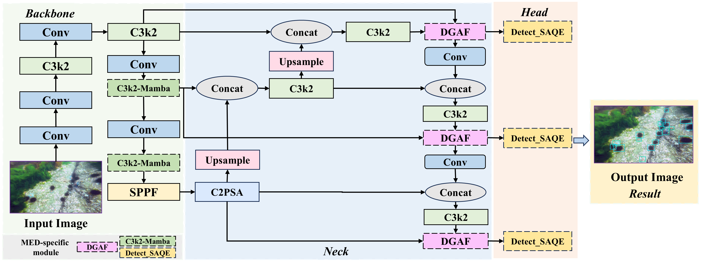
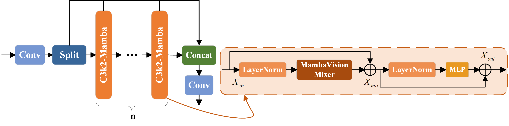
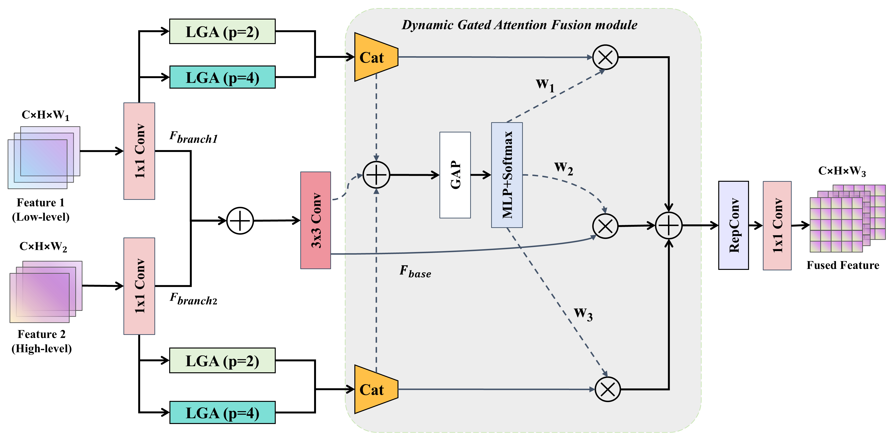
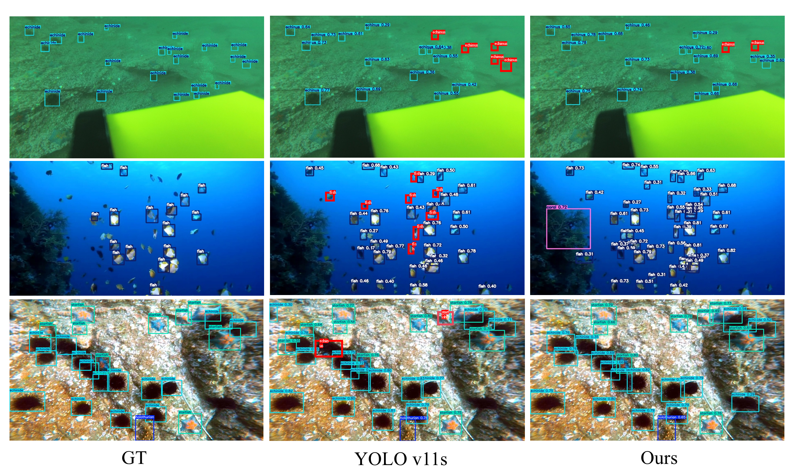

# MED: Mamba-Enhanced Detector for Underwater Imagery

**Global Context Meets Local Quality: A Mamba-Enhanced Detector for Underwater Imagery**

Yaoming Zhuang<sup>1,&#42;</sup>, Zirui Fang<sup>2</sup>, Jiaming Liu<sup>1</sup>, Zixuan Li<sup>2</sup>, Weijia Chen<sup>3</sup>, Yuetong Ma<sup>2</sup>, Zhanlin Liu<sup>4</sup>, and Qiong Zhou<sup>5,&#42;</sup>

<sup>1</sup> Faculty of Robot Science and Engineering, Northeastern University, China  
<sup>2</sup> College of Information Science and Engineering, Northeastern University, China  
<sup>3</sup> School of Mechanical Engineering and Automation, Northeastern University, China  
<sup>4</sup> ProRata.ai, Bellevue, WA, USA  
<sup>5</sup> School of Electronic and Electrical Engineering, Anhui Agricultural University, China

Yaoming Zhuang and Zirui Fang are co-first authors.  
<sup>&#42;</sup> Corresponding authors: [Yaoming Zhuang](mailto:zhuangyaoming@mail.neu.edu.cn) and [Qiong Zhou](mailto:zhouqiong@ahau.edu.cn).

**IEEE Signal Processing Letters, vol. 33, pp. 3551-3555, 2026**  
[Paper](https://doi.org/10.1109/LSP.2026.3727946) · [BibTeX](CITATION.bib)

This repository accompanies our paper on MED, a YOLOv11s-based detector for underwater imagery. MED combines global context modeling, adaptive multi-scale fusion, and localization-quality calibration to address attenuation, non-uniform turbidity, and scattering-induced boundary uncertainty.

> **Release scope:** This repository provides the Mamba backbone and SAQE head source components, paper figures, and citation information. It is a release of selected modules rather than a complete detector package. Trained weights, the DGAF fusion implementation, and end-to-end training/evaluation scripts are not included.

## Pipeline



*Overall framework of MED (Fig. 1): Mamba-enhanced backbone, DGAF multi-scale fusion, and SAQE detection head.*

## Released Code

| File | Components |
| --- | --- |
| [modules/MambaVision.py](modules/MambaVision.py) | MambaVision mixer, attention blocks, and `C3k_MambaVision` / `C3k2_MambaVision` backbone blocks |
| [modules/SAQE.py](modules/SAQE.py) | `MLP`, `LQE`, `Detect_LQE`, and `Detect_SAQE` quality-estimation head |

The extracted classes retain the supplied implementation's class names and forward behavior. The code depends on Ultralytics and requires model-parser integration before use in a detector.

## Performance at a Glance

The following results reproduce the MED rows in the paper's comparative experiments (Tables II and III). All mAP values are percentages.

| Dataset | mAP@0.5 (%) | mAP@0.5:0.95 (%) | Parameters (M) | GFLOPs |
| --- | ---: | ---: | ---: | ---: |
| UDD | 72.4 | 31.0 | 15.50 | 30.1 |
| URPC2020 | 86.6 | 51.0 | 15.50 | 30.1 |
| RUOD | 87.1 | 64.2 | 15.50 | 30.1 |
| Average across three datasets | 82.0 | 48.7 | 15.50 | 30.1 |

These are published results, not reproduced measurements from this module-only repository. The paper's ablation table (Table I) separately reports results with 95% confidence intervals over three seeds.

## Comparative Results on UDD and URPC2020

The table below reproduces all model rows and selected columns from Table II of the published paper. All mAP values are percentages. Precision, recall, the two-dataset averages, and publication-source columns are omitted for readability. Reference numbers refer to the paper's bibliography; MED corresponds to the paper's "Ours" row. A dash indicates that GFLOPs were not reported in the paper.

| Model | Parameters (M) | GFLOPs | UDD mAP@0.5 (%) | UDD mAP@0.5:0.95 (%) | URPC2020 mAP@0.5 (%) | URPC2020 mAP@0.5:0.95 (%) |
| --- | ---: | ---: | ---: | ---: | ---: | ---: |
| YOLOv6s [19] | 16.29 | 43.7 | 65.5 | 28.4 | 83.9 | 49.2 |
| YOLOv7s [20] | 9.33 | 26.0 | 62.0 | 24.1 | 82.2 | 44.3 |
| YOLOv8s [21] | 11.13 | 28.4 | 65.8 | 28.4 | 84.6 | 50.1 |
| YOLOv10s [3] | 8.04 | 24.5 | 68.4 | 28.8 | 84.5 | 49.6 |
| YOLOv12s [22] | 9.07 | 19.3 | 67.8 | 29.2 | 85.0 | 50.4 |
| Hyper-YOLO-s [23] | 13.52 | 33.8 | 67.0 | 29.0 | 84.8 | 50.6 |
| Mamba-YOLO-B [24] | 21.80 | 49.6 | 67.2 | 29.0 | 84.6 | 50.1 |
| RT-DETR(Res50) [25] | 32.66 | 85.1 | 59.2 | 26.2 | 84.2 | 48.2 |
| Dynamic-YOLO [26] | 8.21 | 29.4 | 67.6 | 28.2 | 84.4 | 50.0 |
| VajraV1-small [27] | 11.41 | — | 66.6 | 28.7 | 83.0 | 48.5 |
| U-DECN [28] | 82.00 | 170 | 59.4 | 23.1 | 82.1 | 42.2 |
| LUOD-YOLO-s [29] | 5.91 | 19.9 | 64.8 | 28.1 | 84.3 | 49.5 |
| SU-YOLO [30] | 6.97 | — | 63.3 | 26.2 | 76.8 | 39.3 |
| EAST-YOLO [9] | 2.69 | 6.8 | 67.9 | 28.2 | 82.5 | 47.7 |
| YOLOv11s [31] | 9.41 | 21.3 | 68.0 | 28.1 | 84.9 | 50.8 |
| **MED (Ours)** | **15.50** | **30.1** | **72.4** | **31.0** | **86.6** | **51.0** |

## Comparative Results on RUOD

The table below reproduces all model rows and the overall metrics from Table III of the published paper. All mAP values are percentages. Publication-source and category-specific AP columns are omitted; the complete per-category AP results are available in Table III of the paper. Reference numbers refer to the paper's bibliography; MED corresponds to the paper's "Ours" row.

| Model | Parameters (M) | GFLOPs | RUOD mAP@0.5 (%) | RUOD mAP@0.5:0.95 (%) |
| --- | ---: | ---: | ---: | ---: |
| YOLOv5s [32] | 7.03 | 16.5 | 85.9 | 62.1 |
| YOLOv6s [19] | 16.29 | 43.7 | 85.2 | 62.2 |
| YOLOv8s [21] | 11.13 | 28.4 | 86.3 | 62.9 |
| YOLOv9s [33] | 7.17 | 26.7 | 86.4 | 63.9 |
| YOLOv10s [3] | 8.04 | 24.5 | 86.2 | 63.3 |
| YOLOv12s [22] | 9.07 | 19.3 | 86.5 | 63.9 |
| YOLOv13s [34] | 9.00 | 20.7 | 85.9 | 62.9 |
| YOLO26s [35] | 9.77 | 27.8 | 86.2 | 63.6 |
| Mamba-YOLO-B [24] | 21.80 | 49.6 | 86.3 | 63.6 |
| RT-DETR(Res50) [25] | 32.66 | 85.1 | 85.4 | 61.1 |
| EAST-YOLO [9] | 2.69 | 6.8 | 84.2 | 60.4 |
| YOLOv11s [31] | 9.41 | 21.3 | 85.0 | 62.0 |
| **MED (Ours)** | **15.50** | **30.1** | **87.1** | **64.2** |

## Method Components

MED combines three components:

- **Mamba-enhanced backbone:** Selective state-space modeling propagates global context in the high-level backbone. Mamba-enhanced blocks are placed after the P4/16 and P5/32 downsampling stages.
- **Dynamic Gated Attention Fusion (DGAF):** Content-dependent gating combines structural features with context at multiple scales for the P3, P4, and P5 detection outputs.
- **Scattering-Aware Quality Estimation (SAQE):** A localization-quality estimate calibrates classification confidence when object boundaries are ambiguous.



*Mamba-enhanced backbone block (Fig. 2).* 



*DGAF architecture described in the paper (Fig. 3). Its implementation is outside this code release.*

## Requirements and Integration

The released code imports the following packages and APIs:

- PyTorch (`torch`).
- A YOLO11-capable Ultralytics installation exposing `C3k`, `C3k2`, and `Detect`.
- `timm.layers` (`DropPath`, `Mlp`), `einops`, and `mamba_ssm.ops.selective_scan_interface.selective_scan_fn` for the Mamba backbone.

From the repository root, the released classes can be imported after the dependencies are installed:

```python
from modules.MambaVision import C3k2_MambaVision
from modules.SAQE import Detect_SAQE
```

To integrate these components into an Ultralytics detector, register the custom classes in the model parser. `C3k2_MambaVision` needs the same input/output channel scaling and repeat handling as a backbone block; `Detect_SAQE` needs detection-head handling with the input channels of its feature scales. This repository does not provide a complete model YAML or parser patch.

The supplied SAQE implementation uses top-four probabilities, their mean, and normalized entropy, producing a 24-channel descriptor and a `24 → 64 → 1` quality-estimation MLP. Its compatibility branch supports an existing 20-channel MLP by using top-four probabilities and their mean without entropy. The extraction retains this behavior and the original regression-distribution layout; integration with a complete detector still requires validation.

## Repository Layout

```text
MED/
├── modules/
│   ├── MambaVision.py
│   ├── SAQE.py
│   └── README.md
├── figures/
│   ├── architecture.png
│   ├── mamba_backbone.png
│   ├── dgaf.png
│   ├── detection.png
│   └── README.md
├── CITATION.bib
├── LICENSE
└── README.md
```

## Experimental Environment

The paper reports the following experimental setup:

| Item | Paper setting |
| --- | --- |
| Operating system | Ubuntu 22.04 LTS |
| GPU | NVIDIA GeForce RTX 3090, 24 GB |
| PyTorch | 2.1.2 |
| CUDA | 12.1 |
| Input resolution | 640 × 640 |
| Training epochs | 200 |
| Batch size | 16 |
| Initial learning rate | 0.01 |
| Momentum | 0.937 |
| Initialization | Training from scratch, without pretrained weights |

This table describes the experiments in the paper. It is not a complete installation specification for the released modules.

## Datasets

MED is evaluated on RUOD, UDD, and URPC2020. The paper reports the following dataset sizes:

| Dataset | Categories | Training images | Validation images | Test images |
| --- | ---: | ---: | ---: | ---: |
| RUOD | 10 | 9,800 | 4,200 | — |
| UDD | 3 | 1,558 | 335 | 334 |
| URPC2020 | — | 4,434 | 1,109 | — |

Dataset images, annotations, and split files are not bundled with this repository. A dash indicates that the paper's dataset description does not specify the value.

## Qualitative Results



*Detection examples from the paper (Fig. 4). Columns show ground truth, YOLOv11s, and MED. Red boxes mark missed detections.*

## Citation

If this work is useful in your research, please cite:

```bibtex
@article{zhuang2026med,
  author  = {Zhuang, Yaoming and Fang, Zirui and Liu, Jiaming and Li, Zixuan and Chen, Weijia and Ma, Yuetong and Liu, Zhanlin and Zhou, Qiong},
  title   = {Global Context Meets Local Quality: A {Mamba}-Enhanced Detector for Underwater Imagery},
  journal = {IEEE Signal Processing Letters},
  year    = {2026},
  volume  = {33},
  pages   = {3551--3555},
  doi     = {10.1109/LSP.2026.3727946}
}
```

## License and Acknowledgments

The code retains the source project's AGPL-3.0 license; see [LICENSE](LICENSE). The modules use PyTorch, Ultralytics, and Mamba components.
